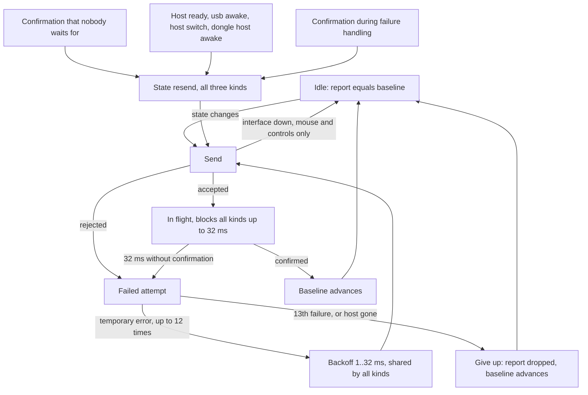
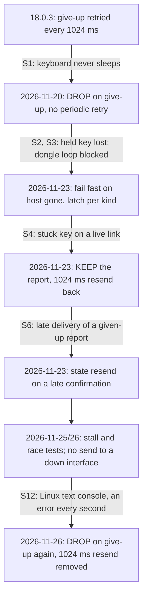

# HID report delivery: what we guarantee and what we don't

How keyboard, mouse and controls reports get to the host. Written on 2026-11-26 for branch `usb-sender-cleanup`, by
Claude with Karel: "my" and "mine" are Claude's.

- Code: `right/src/usb_report_sender.c`, `right/src/usb_semaphore.c`, `right/src/hid/transport.cpp`.
- Tests: `right/src/test_suite/tests/test_transport.c` (module `Transport`).
- History: `journal/usb_retry_teardown.md`.
- Labels: **I** invariant, **R** restriction, **W** wish, **S** scenario from the history.
- Evidence words:
  - **measured**: seen on a real host.
  - **tested**: an on-device test fails without it.
  - **read**: from reading the code only.

## 1. Model

- Three kinds of report: keyboard, controls, mouse. Over USB each has its own interface.
- Each kind has the report being built and the **baseline**: what the host is taken to have.
- A pass sends the kinds whose report differs from the baseline. A report is the full state, not a difference.
- One gate for all kinds: no new pass while a report of any kind is in flight or being retried.

Terms:

- **Give-up:** the report is dropped and the baseline advances as if it was delivered. After 12 retries (about
  290 ms, of which 255 ms is backoff), or at once on a host-gone error.
- **Latch:** set per kind at its give-up. While set, each report of that kind gets one attempt. Cleared by a
  confirmation of that kind or by a state resend.
- **State resend:** marks all three baselines as unknown (`0xff` in byte 0) and clears the latches. The next pass
  sends the current state.
- **Resend pass:** a pass that only retries: it sends again what failed, nothing new. Runs before a normal pass.
  Not a state resend.
- **Trailing pass:** a pass that sent something asks for one more pass. What needs it is not known (I10).
- **Host-gone errors:** `-ENETDOWN`, `-ECONNRESET`, `-ENOTCONN`, `-EPIPE`, `-EHOSTUNREACH`.

## 2. Invariants we support

| # | We guarantee | Needed because of | Evidence |
|---|---|---|---|
| I1 | Sending never blocks longer than 1 s on a stuck host or interface. USB: about 290 ms per give-up. BLE: 1000 ms. | R2, R5, R6 | measured (USB), read (BLE) |
| I2 | A given-up kind pays the 290 ms once. After that each of its reports fails in one attempt, until a state resend (W4). | R2, R7, S3 | measured |
| I3 | Silence when idle: after a give-up nothing is sent until the state changes. | R2, S12 | tested, measured |
| I4 | Mouse and controls are not sent to a USB interface the host didn't start. The keyboard still is (R10). | R1, S10 | tested, measured |
| I5 | A keyboard-only host gets every letter, also when the test drops one in seven sends and confirmations. | R1; rests on I4 | tested |
| I6 | A report the host takes late leaves no stale state: the current state follows it. | R4, S6 | tested |
| I7 | A confirmation racing its report's failure neither loses nor repeats a state. | R9, S8 | tested |
| I8 | A host that comes up gets the current state of all three kinds. | R8, S1, S2 | measured (host ready), read (other triggers) |
| I9 | Reports arrive in the right sequence, also across interfaces. A dropped report leaves a hole, never a swap. | Karel's requirement | tested (a pass waits for retries), read (rest) |
| I10 | A given-up kind asks for no trailing pass, so its failing sends can't loop. The other kinds keep theirs. | S5, S13 | read, no test |
| I11 | A state resend requested during another kind's retries is still carried out. | S14, S15 | tested |
| I12 | A failed or repeated send is not activity: the keyboard sleeps also while its sends fail. | S1 | measured (bench, Karel) |

Who puts the host right after each failure:

| What went wrong | Recovery |
|---|---|
| Send rejected, temporary error | retry with backoff, up to 12 times |
| Accepted, not confirmed in 32 ms (USB, dongle) | retry, as above |
| Accepted, not confirmed (BLE HID) | wait; after 1000 ms disconnect, and one more pass 1024 ms later (this path only) |
| Accepted, taken late, after the give-up | state resend on the late confirmation (I6) |
| Host gone | state resend when it is up (I8) |
| Bus suspended | report dropped at once; state resend at "usb awake" (I8) |
| BLE or dongle link gives up | reconnect, then I8 |
| Rejected while the link holds nothing, no reconnect | nothing (W1) |

## 3. Restrictions we face

| # | Restriction | What it forces | Evidence |
|---|---|---|---|
| R1 | Some hosts start only some interfaces. A boot loader starts the keyboard only. | I4 | measured (GRUB) |
| R2 | Some hosts start an interface and never poll it. A Linux text console does it to the mouse. | I1, I2, I3 | measured |
| R3 | A started interface isn't polled right away. Bench host: over 290 ms. | no send at interface start (S11) | measured |
| R4 | A USB endpoint holds one report and can't take it back. The host gets it at its next poll, however late. | I6 | measured |
| R5 | Confirmation callbacks get lost. Zephyr dropped one once, and HOGP stayed stuck for good. | I1: no wait without a bound | Karel's report |
| R6 | BLE HID keeps an accepted report queued. Resending only duplicates it. | I1: wait, then tear the link down | read |
| R7 | The dongle relays one report at a time in a blocking loop, and has no state to resend. | I2, fail fast on host gone; blocks W3 | read |
| R8 | A report sent into a suspended bus arrives at resume: the wake-up key would be typed. | drop while suspended; I8 | read |
| R9 | Confirmations arrive in callback context and can interrupt the handling of a failure. | I7 | tested |
| R10 | The keyboard report also feeds the macro recorder and the input interceptor. | I4 leaves the keyboard out | read |
| R11 | Mouse movement is a difference, not a state. | a given-up movement is discarded | read |
| R12 | UHK60 and the dongle share this code and were not run. UHK60 was not even built. | nothing here is verified there (W7) | not run |

## 4. Properties that are nice to have

| # | Nice to have | Can we? | Why, or what it takes |
|---|---|---|---|
| W1 | No stuck key, ever. | **Can't** (I3) | Takes a periodic retry, which I3 excludes. Gap accepted by Karel, see note. |
| W2 | A state resend always takes effect. | **Can, not done** | Takes a flag per kind instead of the mark. Karel chose the mark: it fails rarely, see note. |
| W3 | A tap during a short outage (bus reset) is replayed. | Keyboard: **can, not done**. Dongle: **can't** (R7) | Takes retrying a host-gone error like a temporary one. Measure a bus reset first. |
| W4 | No attempts and no error lines towards an unpolled interface (R2). | **Can, not done** | Takes "the endpoint still holds our report" as a known state. See note. |
| W5 | Kinds don't delay each other. | **Can't** (I9) | The shared gate is what keeps the sequence. The delay is bounded by I1. |
| W6 | Every invariant has a test that fails without it. | **Can, partly done** | No test: I1, I2, I8, I10, I12. In part: I9. |
| W7 | The same behaviour on UHK60 and the dongle. | **Unknown** (R12) | Takes a UHK60 build and a dongle on the bench. See note. |
| W8 | No extra reports to a host that always confirms later than 32 ms. | **Unknown** | No such host seen. Today it would get a state resend per report (I6). |
| W9 | The give-up's baseline switch can't race a confirmation (R9). | **Unknown** | Not checked. It can run in callback context, outside the interrupt lock. |
| W10 | Code small enough to keep in one's head. | **Met, must stay** (Karel) | Rules out a state-machine rewrite (S9). |
| W11 | A given-up report that the transport fails later still triggers a state resend. | **Can, not done** | Would send to a gone host at every disconnect (S1). My decision, not Karel's; see note. |

Notes:

- **W1:** the gap is a link that rejects sends while it holds no report of that kind. No confirmation comes, so
  nothing tells us it works again. A dropped key release then waits for the next key event.
  - No real USB trigger is known.
  - BLE and dongle links reconnect instead, except within 10 s of a Bluetooth connect event and in dev mode.
  - The trade: I3 is there against noise on R2 hosts (S12: an error line per second), not for sleep (I12 covers
    that). A periodic retry would close this gap at that price.
- **W2:** a state resend is lost for a kind when
  - its real state starts with `0xff` (all eight modifiers, or the first eight mouse buttons), or
  - the mark is overwritten before the kind is sent: by a confirmation of a report in flight, by a give-up, or by
    pairing and blind macro recording, which switch the keyboard buffers.
- **W4:** today an unpolled interface costs one stall of 290 ms, then one error line per report. Each state resend
  clears the latch, so the 290 ms come again.
- **W7:** UHK60 has "usb awake" but no "host ready". After a re-enumeration without suspend, a held key is not sent
  again (read).
- **W11:** whether the transport ever fails a held report while the link stays up is not shown.

## 5. Scenarios that made us change behaviour

Decisions are Karel's unless marked as mine.

- **Is it a problem?** What the scenario costs the user, and how we know it happens. My reading.
- **Problem still present?** Whether the scenario's problem is still there on this branch. If not, what removed it.
- Rows to look at: a problem in the first of the two columns, and "Yes" or "Partly" in the second.

| # | Date | Scenario | Is it a problem? | Change it caused | Problem still present? |
|---|---|---|---|---|---|
| S1 | 2026-11-20 | A customer's keyboard never slept and showed `-104` bursts: the give-up retried every 1024 ms and failed sends counted as activity. | Not sleeping: yes (battery, backlight). Seen at the customer and on the bench. The retry alone: log lines, which light the OLED when it shows the log. | Two changes: (a) only successful, non-repeated sends count as activity; (b) drop on give-up, no periodic retry, state resend at host ready, host switch, dongle host awake. | No. Sleep: fixed by (a), in the code since then (I12). Log lines: gone by (b), which was reverted by S4 and is back with S12 (I3). |
| S2 | 2026-11-20 | Bench: a key held across a reconnect was not delivered. A global "given up" latch never cleared. | Yes: a lost key. Seen on the bench (Karel). | The latch cleared on state resend and on confirmation. | No (I8). The global latch is gone; the clearing rule lives on per kind. |
| S3 | 2026-11-23 | Without the global latch each failing report blocked the dongle's loop for 255 ms. | Probably: lag on the dongle while its host is away. Read, not measured. | Fail fast on host-gone errors; latch per kind (my proposal). | No, by reading (I2). The latch alone would bound the cost (my observation, 2026-11-26). |
| S4 | 2026-11-23 | A give-up on a link that stays up (host stops polling, no suspend): the dropped key release left the key stuck. Re-enumeration was rejected because of R2. | Yes if it happens: a stuck key. Reasoned, not seen. The case we can name (the endpoint holds the report, R4) is S6. | Keep the report; 1024 ms resend back. | Partly. The named case: no, S6 covers it (I6). The rest: yes, the accepted gap (W1). The change itself was removed by S12. |
| S5 | 2026-11-23 | The kept report looped through the trailing pass and the timeout. | Yes: passes without a pause. Found by reading, not seen. | No trailing pass while any kind is given up. | No, by reading (I10). The rule was narrowed by S13. |
| S6 | 2026-11-23 | The endpoint delivers a given-up report late; if the state went back meanwhile, the host keeps the stale one (my finding F1). | Yes: a stuck key. Found by reading, reproduced on the test sink. Late confirmations are measured on the Linux text console. | State resend on a late confirmation. | No (I6). It is what makes dropping safe. Open corner: W11. |
| S7 | 2026-11-23 | A late confirmation was thrown away before it could clear the latch. | Small: the kind stays latched, so each of its reports gets one attempt. Spotted by Karel in the code. | Any successful confirmation clears its kind's latch. | No. |
| S8 | 2026-11-24 | A confirmation during the handling of a timeout: the report was sent again from the switched buffer, which holds the state before it. | Yes, rarely: the host sees an older state again. A narrow race, reproduced on the test sink only. | Release in one step; state resend when the report was resolved meanwhile. | No (I7). |
| S9 | 2026-11-24 | A rewrite as a state machine was too large to review. | Not for the user. A process problem. | Rejected; small steps instead. | Not applicable. Its "a resend pass leaves a pending send request alone" (mine) was lost with it and came back as S14. |
| S10 | 2026-11-25 | Every boot gave up on mouse and controls with `-104`: their interfaces start after the keyboard's. | Noise: error lines at every boot, and per mouse or controls report on a boot loader. Nothing waits: those sends fail at once. Measured. | No send to an interface that is down. | No (I4). |
| S11 | 2026-11-26 | A send triggered when the interface starts stalled every boot for 290 ms (R3). | Small: all kinds wait 290 ms, once per boot. Measured, 3 of 3 boots. | Trigger removed (my deviation, approved). | No. |
| S12 | 2026-11-26 | Linux text console (R2): the kept mouse report was retried every second and at every key press, forever. | Noise: an error line per second and per key press. No lost or late input seen. Power cost of the timer not measured. | Drop on give-up; 1024 ms resend removed. | Partly. Idle: no, it is silent (I3). While the mouse moves: yes, an error line per mouse report (W4). Final build not measured. |
| S13 | 2026-11-26 | On that console the given-up mouse switched the trailing pass off for the keyboard too. | Unknown: no test and no host shows what needs the trailing pass. | Trailing-pass rule per kind. | No, by reading (I10); no test. |
| S14 | 2026-11-26 | Test sink: a state resend requested while the mouse was being retried never reached the host when no key was held. The resend passes erased the request, and the give-up pass didn't put it back. The 1024 ms resend used to hide this. | Yes: the host misses its state after coming up. Test sink only; needs no key held. | A resend pass leaves the request for a normal pass alone. | No (I11). |
| S15 | 2026-11-26 | The same test still failed: the "unknown" mark of the second state resend undid itself. It was the complement of the active report, which is stale between a delivery and the next normal pass and then holds the previous mark. | As S14; needs two state resends in a row. | A constant mark, `0xff` (Karel's proposal). | No (I11), except the rare cases in W2. |

### Why it went in a circle (my reading)

- **Two fixes for one symptom:** S1 went away with the activity rule alone. The drop went in with it and shared the
  credit, so "no periodic retry" looked like a requirement of sleep. It is a requirement of silence only (S12).
- **Order of events:** "keep" (S4) was chosen to cover "accepted, taken late". The late-confirmation resend (S6), which
  covers exactly that, came a step later, and "keep" was not looked at again.
- **No list of who covers what:** each change answered the one scenario just seen. The recovery table in section 2
  is that list.
- **Rules that only served another rule:** the 1024 ms resend and the trailing-pass rule existed because of kept
  reports, and the resend hid the lost send request of S14.
- **One host at a time:** the bench host polls everything, GRUB starts only the keyboard, the Linux text console
  starts the mouse and never polls it. Each showed a different defect.

## 6. Before changing this again

- **Kept reports** need a retry timer, a guard against the trailing-pass loop (S5) and an answer for R2.
- **Without the late-confirmation resend** dropping is unsafe: I6 falls and S4 is back.
- **Without the latch** every report of a given-up kind costs 290 ms (S3).
- **A periodic retry** doesn't keep the keyboard awake any more (I12). Against it stand the noise on R2 hosts (S12)
  and the trailing-pass loop (S5). For it: W1 and W11.
- **Hosts to check on:** one that polls everything, a boot loader, a Linux text console.
- **A test that holds a key can't see a lost send request:** a held key asks for a pass at every update (S14 passed
  10 of 10 without the fix until the key was released first).
- **A test after a failed one starts dirty:** the reset happens at the test's start, so released keys and a state
  resend are still settling. Wait before setting the scene (`STALL_MOUSE_SINK`).

## 7. Evidence

| Date | Host | Observation |
|---|---|---|
| 2026-11-26 | GRUB over UEFI | keyboard session only; with I4 no error and all counters 0 |
| 2026-11-26 | Linux text console, before the drop | mouse started and not polled; "gave up resending -16" every second without input |
| 2026-11-26 | Linux text console, after the drop | two timeouts, one late confirmation, a give-up; one error per mouse report while moving; then no pass for 73 s |
| 2026-11-26 | bench host | a report sent right when an interface starts is not taken for more than 290 ms |

Not measured: the final build on the Linux text console. The run above had the drop only, without I10 and I11.

What breaks which test (mutation runs on the test sink, 2026-11-25 and 2026-11-26):

| Mutation | Covers | Test that fails |
|---|---|---|
| no state resend on a late confirmation | I6 | `host_stops_polling` |
| failure handled although the report was already released | I7 | `confirmation_races_timeout`, `confirmation_races_failed_send` |
| no state resend when a confirmation raced a failure | I7 | `confirmation_races_failed_send` |
| interface-up check removed | I4 | `boot_mode_typing` (counter check) |
| mouse and controls accepted and never confirmed | I5 | `boot_mode_typing` (lost letters) |
| report kept on give-up | I3 | `given_up_report_is_dropped` |
| a resend pass clears the request for a normal pass | I11 | `resend_request_survives_retries` |
| "unknown" mark derived from the report | I11 | `resend_request_survives_retries` |
| a normal pass runs ahead of another kind's retries | I9 | `resend_request_survives_retries` (order check) |
| old trailing-pass rule (off while any kind is given up) | I10 | none |
